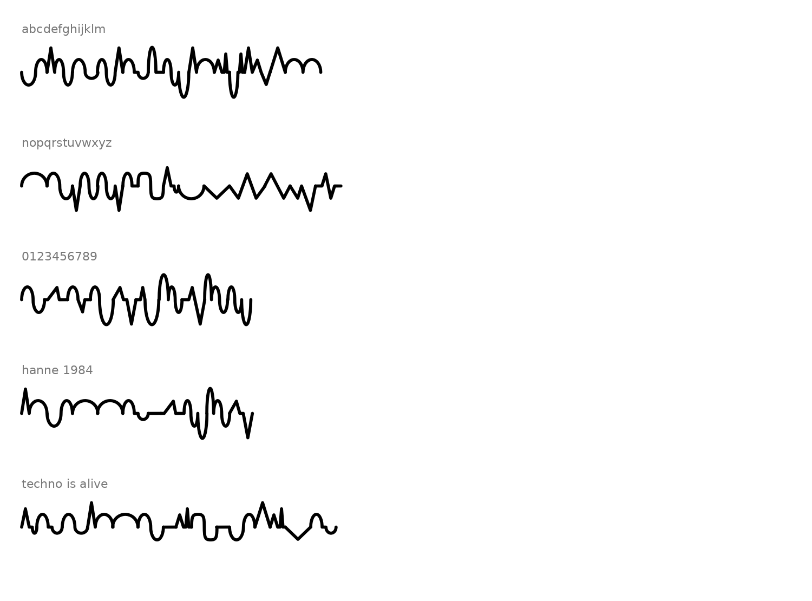

# The Alphabeat

A typeface where every letter is a wave, and every wave is a sound.

Each lowercase letter and number is drawn as one stroke on the classic type guide lines. The same drawing is used as the waveform of a synth, so typing a word plays it as a looping acid-techno bassline.

**Play it:** [hannevervust-glitch.github.io/AlphaBeat](https://hannevervust-glitch.github.io/AlphaBeat/)  
**Third edition, music explained through typography:** [hannevervust-glitch.github.io/AlphaBeat/iii.html](https://hannevervust-glitch.github.io/AlphaBeat/iii.html)  
**Second edition, with music theory:** [hannevervust-glitch.github.io/AlphaBeat/ii.html](https://hannevervust-glitch.github.io/AlphaBeat/ii.html)



## What's here

| Folder | Contents |
|---|---|
| `index.html` | The Alphabeat website: the playable machine and the full system |
| `iii.html` | The Alphabeat III: music explained for typographers, with a type-to-music dictionary, play buttons, and a part-by-part reading of every letter |
| `ii.html` | The Alphabeat II: b d p q as one motif in four forms (prime, retrograde, inversion, retrograde inversion), names as hidden melodies (BACH, DSCH), overtones per letter |
| `font/` | `Alphabeat.otf` (install and type) and `Alphabeat.glyphs` (edit in Glyphs) |
| `drawing-sheets/` | One sheet per character on a 1000 UPM grid with every point's coordinates, as PNG, SVG and one PDF |
| `images/` | Specimen and construction sheet |
| `source/` | The letter recipes (`letters.json`) and the scripts that build the font, check the rules and draw the sheets |

## The system in short

- **Guide lines:** ascender 750, x-height 500, centre 250, baseline 0, descender −250 (1000 UPM). Every character starts and ends on the centre line, so text is one continuous wave. A space is a flat stripe.
- **Anatomy → wave:** stems are spikes, bowls are a hump then a valley, arches are humps, open curves are shallow dips, diagonals are sharp slants, crossbars are flat, hooks are curves, dots are small spikes.
- **Families:** built from n and o, like a real lowercase. b d p q are mirrors and flips; u is n upside down; m is two n's.
- **Numbers:** oldstyle figures (0 1 2 at x-height, 6 8 rise, 3 4 5 7 9 drop), one shared width, and each digit is a step of the A minor scale.

## The sound

- The letter's drawing is looped as one vibration (wavetable synthesis): curves sound warm, corners buzz.
- Letters climb the A minor scale; tall letters go up an octave with an accent, tail letters drop into the sub bass.
- A resonant filter gives the acid squelch; vowels slide like a TB-303; dots ratchet; double letters tie.
- Kick, hi-hat and clap are synthesized live at 128 BPM. Nothing is sampled.

## Rebuild

```
pip install fonttools ufoLib2 ufo2ft glyphsLib shapely matplotlib pillow
cd source
python3 check.py      # every character against the rules
python3 build2.py     # font + Glyphs file into source/out
python3 export_letters.py
```

The Alphabeat by Hanne Vervust and collaborators.
